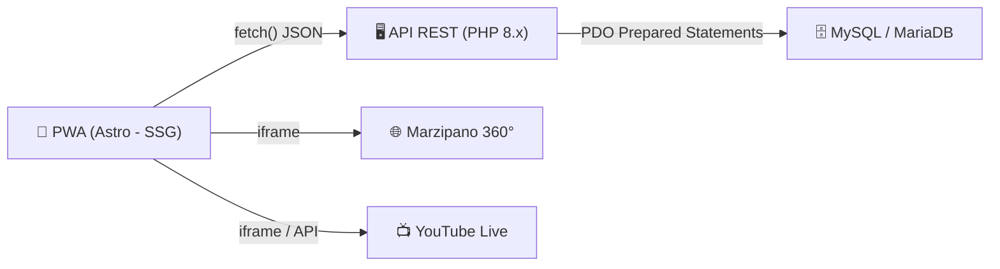

# 📱 Documento Maestro de Arquitectura y Especificación Técnica (SRS)

## Aplicación Móvil PWA — Concejo Municipal de Chía

| Campo | Valor |
|---|---|
| **Versión** | 2.0 (Especificación Detallada) |
| **Líder Técnico** | Jaider David Bernal Canasto (Apoyo Administrativo - Prensa) |
| **Entorno de Despliegue** | cPanel (Infraestructura Institucional) |
| **Dominio de Producción** | `app.concejodechia.gov.co` |
| **Repositorio** | *(Por definir - GitHub)* |

---

## 1. Arquitectura del Sistema (Patrón Cliente-Servidor Desacoplado)

El sistema opera bajo una **arquitectura desacoplada** donde el Frontend y el Backend funcionan de manera independiente, comunicándose exclusivamente a través de una **API RESTful** en formato JSON.



### 1.1. Frontend (Capa de Presentación - PWA)

| Aspecto | Tecnología |
|---|---|
| **Framework** | Astro (SSG + renderizado híbrido) |
| **Lenguajes** | HTML5, CSS3, JavaScript/TypeScript |
| **PWA - Manifiesto** | `manifest.json` — colores institucionales, nombre corto, array de íconos (PNG/SVG) |
| **PWA - Service Worker** | `sw.js` — intercepta peticiones de red, habilita **navegación offline parcial** (app shell + datos recientes cacheados), gestiona caché de recursos estáticos |
| **UI/UX** | Componentes modulares. Diseños base vectorizados en Affinity Designer |

> [!IMPORTANT]
> **Estrategia de caché del Service Worker (Fase 1):** Implementar caché medio — el app shell (navegación, layout, estilos) se cachea para uso offline, más las últimas noticias y agenda consultadas quedan disponibles sin conexión. Usar estrategia *Cache First* para assets estáticos y *Network First* con fallback a caché para datos de la API.

### 1.2. Backend (Capa de Negocio y API)

| Aspecto | Tecnología |
|---|---|
| **Lenguaje** | PHP 8.x |
| **Patrón de Diseño** | MVC simplificado para APIs |
| **Seguridad** | PDO (PHP Data Objects) — consultas preparadas (mitigación SQL Injection) |
| **Autenticación (Fase 2)** | Tokens JWT o sesiones seguras HTTP-only para login de ciudadanos |

### 1.3. Base de Datos (Capa de Persistencia)

| Aspecto | Detalle |
|---|---|
| **Motor** | MySQL / MariaDB (nativo en cPanel) |
| **Collation** | `utf8mb4_unicode_ci` (soporte completo de caracteres especiales y emojis) |

---

## 2. Estructura de Directorios del Proyecto

### 2.1. Estructura del Frontend (Astro)

```text
/
├── public/                 # Archivos estáticos
│   ├── icons/              # Íconos de la PWA (generados en Affinity Designer)
│   ├── manifest.json       # Manifiesto de la PWA
│   └── sw.js               # Service Worker
├── src/
│   ├── components/         # Componentes reutilizables (Tarjetas, NavBars)
│   ├── layouts/            # Plantillas maestras de página
│   ├── pages/              # Rutas de la aplicación (index.astro, noticias.astro)
│   └── styles/             # Hojas de estilo globales (CSS)
├── astro.config.mjs        # Configuración del framework
└── package.json            # Dependencias del proyecto
```

### 2.2. Estructura del Backend (PHP API)

```text
/api/
├── config/                 # Conexión PDO a la base de datos MySQL
│   └── database.php
├── controllers/            # Lógica de las peticiones
│   ├── NoticiasController.php
│   ├── AgendaController.php
│   └── AdminController.php # Panel administrativo básico
├── models/                 # Lógica de la base de datos
│   ├── Noticia.php
│   ├── Evento.php
│   └── Documento.php
└── public/                 # Puntos de entrada de la API (Endpoints)
    ├── get_noticias.php
    ├── get_agenda.php
    ├── get_documentos.php
    └── admin/              # Endpoints del panel admin
        ├── crear_noticia.php
        ├── editar_noticia.php
        ├── crear_evento.php
        ├── editar_evento.php
        ├── crear_documento.php
        └── editar_documento.php
```

---

## 3. Modelo de Datos (Esquema MySQL Relacional)

### 3.1. Tablas en Producción (Base de Datos Existente `concejom_concejo`)

La aplicación PWA se conecta directamente a la base de datos existente del sitio web institucional (`concejom_concejo`), evitando duplicar la publicación de información:

#### Tabla: `noticoncejo` (Noticias del Concejo)

| Columna Principal | Mapeo App | Descripción |
|---|---|---|
| `id` / `id_noticia` | `id_noticia` | Identificador único de la noticia |
| `titulo` / `titular` | `titulo` | Titular del boletín de prensa |
| `contenido` / `descripcion` | `contenido` | Cuerpo completo del artículo |
| `imagen` / `url_imagen` | `url_imagen` | Ruta o URL de la imagen destacada |
| `fecha` / `fecha_pub` | `fecha_pub` | Fecha y hora de publicación |
| `estado` / `activo` | `estado` | Estado para visibilidad en la app |

#### Tabla: `docpubli` (Documentos Oficiales)

| Columna Principal | Mapeo App | Descripción |
|---|---|---|
| `id` / `id_doc` | `id_doc` | Identificador del documento |
| `nombre` / `titulo` | `nombre` | Nombre del acuerdo, resolución o acta |
| `categoria` / `id_tipo` | `categoria` | Tipo de publicación (mapeado a `tpublicaciones`) |
| `archivo` / `url_pdf` | `url_pdf` | Ruta al archivo PDF en cPanel |
| `fecha` / `fecha_sub` | `fecha_sub` | Fecha de expedición/subida |

#### Tabla: `tpublicaciones` (Categorías de Documentos)

Categorías oficiales de documentos (Acuerdos Municipales, Resoluciones, Actas Plenarias, Circulares).

#### Tabla: `agenda` (Agenda de Sesiones)

Eventos y sesiones programadas con transmisión de YouTube.

#### Tabla: `usuario` / `admin_usuarios` (Acceso Administrativo)

Usuarios administradores del sistema web para autenticación del panel.

> [!NOTE]
> La tabla `admin_usuarios` es para el panel de administración interno (equipo de prensa). Es independiente de la tabla `usuarios` de Fase 2, que será para ciudadanos.

### 3.2. Tablas — FASE 2 (Interactividad y Usuarios Ciudadanos)

*(Estructura proyectada para la segunda etapa de desarrollo)*

| Tabla | Columnas principales |
|---|---|
| `usuarios` | `id_user`, `nombre`, `email`, `password_hash`, `fecha_registro` |
| `concejales` | `id_concejal`, `nombre`, `partido`, `biografia`, `foto_url` |
| `encuestas` | `id_encuesta`, `pregunta`, `fecha_cierre`, `estado` |
| `suscripciones` | `id_user` (FK), `id_concejal` (FK) → Tabla pivote |

---

## 4. Diseño de Endpoints de la API REST

> [!IMPORTANT]
> Todas las respuestas del servidor PHP deben devolver `Content-Type: application/json`.

### 4.1. Endpoints Públicos (Fase 1)

| Método | Endpoint | Propósito |
|---|---|---|
| `GET` | `/api/public/get_noticias.php` | Retorna array con las últimas noticias activas |
| `GET` | `/api/public/get_agenda.php?mes=08&anio=2026` | Retorna eventos programados para un mes específico |
| `GET` | `/api/public/get_documentos.php` | Retorna listado de documentos (acuerdos, resoluciones) |

### 4.2. Endpoints Admin (Fase 1 — Panel de Prensa)

| Método | Endpoint | Propósito |
|---|---|---|
| `POST` | `/api/admin/crear_noticia.php` | Insertar un nuevo boletín |
| `PUT` | `/api/admin/editar_noticia.php` | Editar una noticia existente |
| `POST` | `/api/admin/crear_evento.php` | Crear un nuevo evento en la agenda |
| `PUT` | `/api/admin/editar_evento.php` | Editar un evento existente |
| `POST` | `/api/admin/crear_documento.php` | Subir un nuevo documento |
| `PUT` | `/api/admin/editar_documento.php` | Editar un documento existente |
| `POST` | `/api/admin/login.php` | Autenticar al admin (sesión interna) |

> [!NOTE]
> Los endpoints admin requieren validación de sesión interna. En Fase 1 se implementa autenticación básica con sesiones PHP (HTTP-only cookies). JWT se considerará para Fase 2.

---

## 5. Integraciones Multimedia y Herramientas Externas

### 5.1. Recorrido 360° (Marzipano)

- Las imágenes se capturan con cámara **Insta360** y se procesan en **Marzipano Tool**.
- La carpeta exportada (`/recorrido`) se aloja en la raíz del cPanel.
- La app consume el recorrido mediante:

```html
<iframe src="https://app.concejodechia.gov.co/recorrido" width="100%" height="100vh"></iframe>
```

### 5.2. Transmisiones en Vivo (YouTube)

- Se utiliza la etiqueta `<iframe>` estándar de YouTube.
- Alternativa: **API de datos de YouTube V3** para obtener dinámicamente el último video en vivo del canal del Concejo.

---

## 6. Panel de Administración (Fase 1 — MVP)

> [!IMPORTANT]
> Se incluye un panel admin básico en Fase 1 para que el equipo de prensa pueda gestionar contenido sin intervención técnica.

### Funcionalidades del Panel Admin

- **Noticias:** Crear, editar, activar/desactivar boletines.
- **Agenda:** Crear y editar eventos con fecha, hora y enlace a YouTube.
- **Documentos:** Subir acuerdos/resoluciones con categoría y archivo PDF.
- **Autenticación:** Login con usuario/contraseña (sesiones PHP seguras).
- **Roles:** Admin (acceso total) y Editor (solo crear/editar contenido).

### Ubicación en el proyecto

El panel admin será una sección protegida dentro de la PWA, accesible desde una ruta como `/admin`. No será visible en la navegación pública.

---

## 7. Plan de Ejecución Ágil (Sprints Semanales)

### Sprint 1: Setup y UI/UX Base
- [ ] Creación de repositorio en GitHub
- [ ] Inicialización del proyecto Astro
- [ ] Configuración del `manifest.json` y validación PWA
- [ ] Maquetación (HTML/CSS) de la barra de navegación inferior y vistas principales vacías

### Sprint 2: Desarrollo Frontend Estático
- [ ] Creación de tarjetas de noticias estáticas
- [ ] Diseño visual de la vista de agenda y repositorio de documentos
- [ ] Integración del iFrame con el proyecto de Marzipano exportado

### Sprint 3: Backend Base, Base de Datos y Panel Admin
- [ ] Creación de la base de datos MySQL en cPanel
- [ ] Ejecución de scripts DDL (`CREATE TABLE`)
- [ ] Desarrollo de los endpoints `GET` en PHP para Noticias, Agenda y Documentos
- [ ] Desarrollo del panel de administración básico (CRUD noticias, agenda, documentos)
- [ ] Implementación de autenticación admin con sesiones PHP

### Sprint 4: Integración y Despliegue del MVP (Fase 1)
- [ ] Sustitución de datos estáticos en Astro por peticiones `fetch()` a la API PHP
- [ ] Implementación del Service Worker con caché medio (app shell + datos recientes)
- [ ] Ajustes de CORS (Cross-Origin Resource Sharing) en el servidor
- [ ] Compilación de Astro (`npm run build`)
- [ ] Subida de archivos a cPanel mediante FTP/Administrador de Archivos
- [ ] Pruebas en dispositivos físicos

---

## 8. Convenciones y Reglas para Agentes de IA

> [!CAUTION]
> Todo agente de IA que trabaje en este proyecto **DEBE** seguir estas reglas.

### Generales
1. **Idioma:** Todo el código, comentarios y commits deben estar en **español** a menos que sea una convención técnica (nombres de funciones PHP, métodos HTTP, etc.).
2. **Estructura:** Respetar la estructura de directorios definida en la sección 2. No crear carpetas o archivos fuera de esta estructura sin documentarlo aquí.
3. **Base de datos:** Toda consulta SQL debe usar **PDO con prepared statements**. Nunca concatenar variables directamente en queries.
4. **API:** Todas las respuestas de la API deben ser JSON con `Content-Type: application/json`.
5. **Astro:** Usar componentes `.astro` para todo el frontend. Solo usar JS vanilla o TypeScript para interacciones del cliente.

### Seguridad
1. Nunca exponer credenciales de base de datos en el frontend.
2. Validar y sanitizar todos los inputs tanto en frontend como en backend.
3. El panel admin debe validar la sesión en cada request.
4. Las contraseñas deben almacenarse con `password_hash()` de PHP.

### Despliegue
1. El build de Astro (`npm run build`) genera archivos estáticos en `/dist`.
2. Los archivos estáticos se suben a la raíz del dominio en cPanel.
3. La carpeta `/api` se mantiene separada en el servidor.

---

## 9. Identidad Visual Institucional

Basado en el Manual de Identidad Visual v2.0 (2026) del Concejo Municipal de Chía, en cumplimiento de la Ley 2345 de 2023.

### 9.1. Paleta de Colores Oficial

| Color | Nombre | HEX | RGB | Uso |
|---|---|---|---|---|
| Verde Institucional | #009741 | R:0 G:151 B:65 | Color secundario, éxito, elementos naturales |
| Verde Oscuro | #007A34 | (derived) | Gradientes, hover states |
| Verde Claro | #00A94D | (derived) | Fondos suaves, highlights |
| Amarillo Oro (Bandera) | #FFD402 | R:255 G:212 B:2 | Color acento, CTAs, badges destacados |
| Amarillo Suave | #EFD18C | R:239 G:209 B:140 | Fondos cálidos, estados suaves |
| Azul Escudo | #3359A4 | R:51 G:89 B:164 | Color primario, botones, nav activo, header, enlaces |
| Azul Claro | #0384BA | R:3 G:132 B:186 | Acentos secundarios |
| Rojo Escudo | #E30D21 | R:227 G:13 B:33 | Errores, EN VIVO, alertas, PDF icons |
| Marrón Escudo | #5F3913 | R:95 G:57 B:19 | Reservado para aplicaciones especiales |
| Negro | #000000 | R:0 G:0 B:0 | Textos de máximo contraste (uso limitado) |

> [!NOTE]
> Los colores amarillo y verde (bandera municipal) son PRIORITARIOS según el manual. Azul y rojo (escudo) son secundarios.

### 9.2. Tipografía

| Uso | Tipografía |
|---|---|
| Tipografía Institucional (Manual) | Montserrat (sans-serif, geométrica) |
| Tipografía App - Títulos | Outfit (600, 700) |
| Tipografía App - Cuerpo | Inter (400, 500, 600) |

> [!NOTE]
> Se usa Inter + Outfit en la app por modernidad y legibilidad en pantallas móviles. Montserrat queda como referencia para piezas gráficas externas.

### 9.3. Imagotipo y Marca

- El imagotipo del Concejo es un conjunto de texto + símbolo (escudo con Puente del Común como corona)
- Área de seguridad: 2x alrededor del imagotipo (donde x = altura de la letra 'n')
- Tamaño mínimo digital: 70.8px de ancho (horizontal) o 56.6px de alto (vertical)
- Versiones permitidas: original, positiva (blanca), negativa, tintas especiales (dorada/plateada)
- Prohibido: cambiar colores, deformar, cambiar tipografías, agregar efectos no autorizados

### 9.4. Elementos de Diseño en la App

- **Franja bicolor**: El header incluye una franja delgada (4px) amarillo (#FFD402) / verde (#009741), representando la bandera de Chía
- **Header**: Fondo azul institucional #3359A4
- **Botón CTA principal**: Amarillo oro #FFD402 con texto oscuro #212121
- **Indicador EN VIVO**: Rojo escudo #E30D21 con animación pulsante
- **Badges/Tags**: Azul institucional #3359A4 o amarillo #FFD402 según contexto

### 9.5. Información de Contacto Institucional

| Dato | Información |
|---|---|
| Dirección | Kr 7a #11-25, Concejo Municipal de Chía, C.A.M |
| Teléfono | (601) 863 1125 |
| Email | contactenos@concejomunicipalchia.gov.co |
| Web | www.concejomunicipalchia.gov.co |
| Redes Sociales | @Concejodechia |

---

## 10. Decisiones Técnicas Tomadas

| # | Decisión | Contexto | Fecha |
|---|---|---|---|
| 1 | Panel admin incluido en Fase 1 | Se necesita que el equipo de prensa pueda gestionar contenido desde el inicio | 2026-08-18 |
| 2 | Service Worker con caché medio | App shell + datos recientes disponibles offline; estrategia Cache First (assets) + Network First (API) | 2026-08-18 |
| 3 | Autenticación admin con sesiones PHP | JWT se difiere a Fase 2; sesiones HTTP-only son suficientes para el panel interno | 2026-08-18 |
| 4 | Rebrand con identidad visual institucional | Aplicación del Manual de Identidad Visual v2.0 (2026). Verde #009741 y amarillo #FFD402 como colores prioritarios. Franja bicolor en header. | 2026-08-18 |
| 5 | Swap azul como primario | Se cambió azul (#3359A4) a color primario y verde (#009741) a secundario para coherencia con la página web institucional existente. | 2026-08-18 |

---

## 11. Changelog

> Registro de cambios significativos del proyecto. Actualizar con cada modificación relevante.

| Fecha | Autor | Descripción del cambio |
|---|---|---|
| 2026-08-20 | Jaider Bernal / IA | Conexión directa a la BD real `concejom_concejo` (tablas `noticoncejo` y `docpubli`) para sincronización automática con el sitio web. |
| 2026-08-18 | Jaider Bernal / IA | Rediseño estético del Hero en inicio (badge institucional, tipografía destacada, fondo gradiente con glow oro) y adición del banner de Transmisión EN VIVO en directo. |
| 2026-08-18 | Jaider Bernal / IA | Swap de colores: azul #3359A4 como primario, verde #009741 como secundario. Coherencia con web institucional. |
| 2026-08-18 | Jaider Bernal / IA | Rebrand completo con identidad visual institucional. Se actualizó paleta de colores, header con franja bicolor, y se documentó la identidad visual en AGENT.md. |
| 2026-08-18 | Jaider Bernal / IA | Creación del documento maestro AGENT.md a partir del Word original. Se incorporaron decisiones sobre panel admin (Fase 1), nivel de caché del SW y estructura de endpoints admin. |

---

*Última actualización: 2026-08-18*
